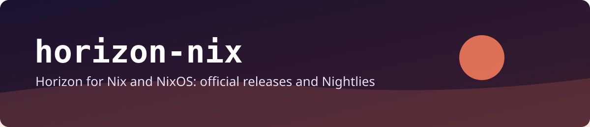

<p align="center">
  
</p>

<p align="center">
  <a href="https://github.com/madebycli/horizon-nix/actions/workflows/ci.yml"></a>
  <a href="https://github.com/madebycli/horizon-nix/actions/workflows/update-upstream.yml"></a>
  
  
</p>

<p align="center">
  Native, reproducible Nix packaging for <a href="https://github.com/horizon-rust/horizon">Horizon</a>, Minecraft: Java Edition rewritten in Rust: the official release and the Nightly, side by side.
</p>

## Quick start

```bash
nix run github:madebycli/horizon-nix                      # the launcher
nix profile add github:madebycli/horizon-nix#horizon-launcher
```

The launcher installs, prepares and updates the game itself. You need your own copy of Minecraft: Java Edition 26.3 on a Microsoft account that owns it; Horizon ships none of Mojang's files.

## Packages

| Package | What | Source |
|---|---|---|
| `horizon-launcher` (default) | The launcher, in a FHS environment so the game it downloads runs on NixOS | newest `launcher@X.Y.Z` release |
| `horizon` | Game client, `horizon-ctl`, `horizon-prepare`, `horizon-server`, natively patched | newest numbered game release (`vX.Y.Z`) |
| `horizon-nightly` | the same | newest dated Nightly (`nightly-YYYY-MM-DD`) |
| `horizon-server` | Dedicated server (no ALSA/udev needed) | newest numbered game release |
| `horizon-server-nightly` | the same | newest dated Nightly |

Horizon ships only Nightlies for the game since 2026-10-28, so the numbered `release` is frozen at its last version. The launcher has no Nightly channel of its own. A dated Nightly stays on GitHub for about a week: the pin is bumped daily, but an old checkout of this repository can no longer download an expired Nightly.

```bash
nix run github:madebycli/horizon-nix#horizon-nightly      # game from the Nightly
nix run github:madebycli/horizon-nix#horizon-server       # server from the release
```

## NixOS

```nix
{
  inputs.horizon-nix.url = "github:madebycli/horizon-nix";

  # in your modules:
  imports = [ inputs.horizon-nix.nixosModules.default ];

  programs.horizon = {
    enable = true;
    channel = "nightly";        # "release" (default) or "nightly": game and server packages
    launcher.enable = true;     # default
    game.enable = false;        # horizon-client, horizon-ctl, horizon-prepare outside the launcher
    server.enable = false;      # horizon-server
  };
}
```

The module also enables `hardware.graphics` (the graphics driver is the host's; the packages only load it). Only `x86_64-linux` is packaged.

Overlay: `nixpkgs.overlays = [ inputs.horizon-nix.overlays.default ];` adds `horizon-launcher`, `horizon`, `horizon-nightly`, `horizon-server`, `horizon-server-nightly`.

## How pins work

`releases.json` holds, per channel, the tag and the SHA-256 of each archive. `scripts/update.py` fills it from the release's own `SHA256SUMS` **after** its Ed25519 signature verified against Horizon's pinned release key; it does not download the archives. A key rotation or a missing signature stops the update instead of weakening it.

The pins are kept up to date by GitHub Actions: **Update upstream release** runs daily at about 04:07 Berlin time (and on demand under Actions → Run workflow). It resolves the newest releases, verifies the signatures, runs the flake checks and builds the packages, and only then commits `releases.json` to `main`, like the other `*-nix` repositories. A fresh checkout with empty hashes builds nothing and says so (the unpinned placeholder fails with an explanation).

Optionally, on your own machine:

```bash
python3 scripts/update.py --check            # exit 1 when stale or unpinned
python3 scripts/update.py --verify           # re-verify the pins in releases.json
```

## What the launcher does under Nix

- It runs in a `buildFHSEnv` with the usual libraries and `/run/opengl-driver`, because it downloads standard Linux binaries (the game) that need `/lib64` and a normal library path, as `twintail-nix` does for its launcher.
- It never replaces itself (`HORIZON_LAUNCHER_NO_SELF_UPDATE=1`): update through this flake. The game and its versions are still managed by the launcher in `~/.local/share/horizon`.

## Development

```bash
nix develop
python3 tests/update_test.py                 # selection, checksums, signatures
python3 tests/install_layout_test.py         # builds all packages from fake archives
nix flake check --print-build-logs
```

`tests/install_layout_test.py` builds every package from archives with the layout Horizon's workflows produce, so the install phases, the wrappers and the FHS environment are exercised without the real binaries. What it cannot show: that Horizon's real binaries start, that the graphics stack works on your GPU, and that Horizon's archives keep this layout.

## Licensing

The packaging code is licensed under GPL-3.0-only. Horizon is MIT and unofficial; see [`NOTICE.md`](NOTICE.md). This repository is an independent packaging integration and is not an official Horizon distribution.
